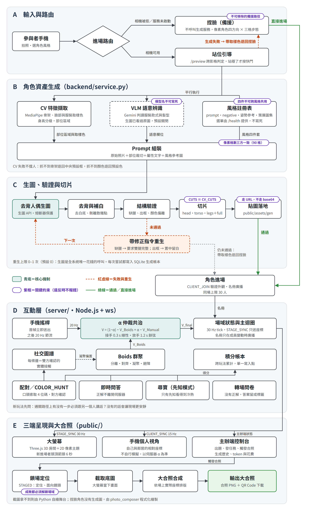

中華民國115年12月

# 數位轉譯角色空間互動系統

指導老師：林坤誼

【待補學號】巫冠儀　【待補學號】周庭伊　【待補學號】廖振廷
【待補學號】劉澤文　【待補學號】康恩瑋

---

# 摘要

本專題製作成果展針對婚宴、迎新等多人聚會中，參與者「同處一室卻各自低頭滑手機」的現象，提出「轉譯而非禁止」的互動方案，實作一套「數位轉譯角色空間互動系統」（系統名稱 PixelAir）。系統不要求參與者放下手機，而是把手機變成控制器，把個人注意力導向全場共享的大螢幕，再用任務把注意力拉回身邊的人。

系統分為三端、兩層。參與者用手機拍照或從相簿選一張全身照，電腦視覺（MediaPipe、OpenCV）先判斷是否全身入框並擷取服裝色彩，再由影像生成模型一次畫出正面、側面、背面三視圖的像素風角色。生成失敗時一律降級為「素體換裝」，不擋人進場。角色進入大螢幕後，由「半自主共治引擎」以連續權重 α 混合手機搖桿輸入與 Boids 群體演算法。主辦端依場合編排節目單，發布人物賓果、配對、找同類、找顏色、即時問答、文字雲等玩法。每種玩法都依「通關路徑上必須開口跟別人說話」的判準設計。活動最後依當天的互動關係排出集體大合照，並提供 QR Code 下載。

民國115年10月19日於本校科技系迎新活動進行場域實測，共25人簽署同意書並完成前後測問卷。當天角色生成成功率為92%，生成時間中位數為16.9秒。前後測比較顯示，參與者對在場群體的歸屬感由2.52分升至3.40分，與在場同學的認識程度由2.44分升至2.88分，活動中使用手機做無關事情的頻率由2.32分降至1.64分。三項差異經 Wilcoxon 符號等級檢定皆達 .05 顯著水準。參與者最常提到的優點是賓果與生成角色；主要問題是移動卡頓與斷線，「使用過程中沒有遇到卡住、斷線或延遲」一題平均只有2.77分。自動化測試方面，Node.js 單元測試678項、Python 後端測試569項全數通過。

關鍵字：數位轉譯、虛實混合互動、半自主共治、Boids 群體演算法、生成式人工智慧、破冰設計

---

# 目錄

第一章　緒論
　一、研究緣起
　二、研究目的
　三、研究範圍與限制
第二章　文獻分析（理論基礎）
　一、理論背景
　二、相關案例與競品分析
　三、關鍵技術基礎
第三章　設計企劃案
　一、設計理念
　二、方法技巧
　三、執行過程
第四章　結果分析
　一、功能完成度
　二、效能量測
　三、自動化測試
　四、角色生成結果
　五、場域實測結果
　六、問題與討論
第五章　結語
　一、結論
　二、研究限制
　三、未來展望
參考文獻

（頁碼於定稿排版後補入）

# 圖次

圖2-1　競品定位矩陣圖【待插入】
圖3-1　系統架構圖（docs/diagrams/arch.png）
圖3-2　參與者入場流程圖【待插入】
圖4-1　像素風角色三視圖生成範例【待插入】
圖4-2　手機控制器、大螢幕與主辦端畫面【待插入】
圖4-3　實測當天依互動排位的集體大合照【待插入：data/photos/ 內 10/19 13:56–13:58 的成品，須確認入鏡者皆同意】
圖4-4　前後測三項指標變化圖【待插入】
圖4-5　場域實測現場紀錄【待插入：僅限同意公開照片者】

# 表次

表2-1　相關案例比較表
表3-1　系統組成表
表3-2　互動玩法設計表
表3-3　開發里程碑
表4-1　功能完成度
表4-2　效能量測結果
表4-3　自動化測試結果
表4-4　實測當天角色生成統計
表4-5　實測流程與參與人數
表4-6　系統互動紀錄
表4-7　前後測比較
表4-8　回饋問卷描述統計
表4-9　開發過程中已解決之問題

---

# 第一章　緒論

## 一、研究緣起

婚宴、同學會、迎新這類多人聚會，參與者雖然在同一個空間，卻常各自低頭滑手機。這個現象可以拆成兩個問題：第一，人在同一個地方，不代表心理上有連結；第二，缺少破冰的媒介，不熟的人同桌也不知道怎麼開口。

常見做法是「禁止」，例如要求收起手機，但這違反現代人使用手機的習慣。本專題換一個方向：與其對抗手機，不如轉譯手機的使用，讓手機從隔開人的屏障，變成促成對話的工具。

本組實測前的基本問卷也呼應這個問題。25位參與者過去兩個月平均參加1.48場迎新活動，自評在那些活動中「使用手機瀏覽與活動無關的事」的頻率平均2.32分（五點量表），常見原因包括「有些時間比較尷尬」「沒人聊天」「空檔很多就會開手機」「不喜歡社交」。參與者同意「在陌生環境中，我需要與他人認識的契機」的平均分數為3.52，「開口跟陌生人搭話對我來說很容易」只有2.52。換句話說，多數人並不排斥認識別人，而是缺少開口的理由。

## 二、研究目的

（一）建構一套場域互動系統，將參與者的穿著特徵轉譯為插畫角色，投射到全場共享的大螢幕。

（二）設計「實轉虛、虛轉實」的互動迴路，用虛擬任務引導實體空間中的對話與走動，並以集體大合照作為活動的紀念。

（三）在真實場域實測，以前後測問卷、回饋問卷與系統互動紀錄，初步檢視系統對歸屬感、認識程度與手機使用行為的影響。

## 三、研究範圍與限制

本專題以婚宴為最初的設計情境，並以可切換的場景主題支援交誼、企業團建、新生訓練、社團迎新等場合。婚宴場域不易取得，實測改在本校科技系的迎新活動進行。

技術上的限制如下：同時在場人數上限為40人；手機開相機必須在 HTTPS 下；角色生成依賴外部影像生成服務，需要網路與付費額度；換裝雖然不呼叫外部服務，但仍需本機生成服務在運作。實測只有一場、25人，屬於初探性質，結果不宜推論到其他族群。

---

# 第二章　文獻分析（理論基礎）

## 一、理論背景

（一）自我呈現理論：Goffman（1959）以劇場比喻指出，人在社交場合中會持續管理自己的形象，這種印象管理在半熟識的場合特別有壓力。本系統以插畫角色作為一層可控制的「前台」，參與者先以角色的身分互動，降低直接搭訕的心理負擔。

（二）社會臨場感理論：Short、Williams 與 Christie（1976）以社會臨場感描述媒介傳達「對方真的在場」的程度。本系統不以虛擬互動取代實體互動，而是讓大螢幕成為全場共同注視的焦點，讓分散在各處的人有共同話題。

（三）集體記憶：Halbwachs（1992）指出群體記憶需要依附在共享的符號與物件上。活動尾聲的集體大合照讓每個參與者的角色都入鏡，成為「我們曾一起在場」的紀念物。

【待確認：程式庫技術文件另提及 de Souza e Silva（2006）的混合空間理論。如組內確實閱讀並引用，請由文獻負責人補一段；未閱讀者請勿列入。】

【待確認：進場人格問卷採用 DISC 四型分類（老虎、孔雀、無尾熊、貓頭鷹）。如要在報告中說明其理論來源（Marston, 1928），請由實際讀過的組員補寫；未閱讀者請只寫「參考坊間常見的 DISC 分類」。】

## 二、相關案例與競品分析

本專題檢視五類相關案例，比較如表2-1。以「群體性（單人體驗至多人共創）」與「實體整合度（純虛擬至虛實混合）」兩軸定位，本系統位於「多人共創 × 虛實混合」的象限，同時具備個人化分身、群體即時互動與實體場域整合三項特性。

表2-1　相關案例比較表

| 案例類型 | 個人化分身 | 群體互動 | 實體場域整合 | 主要限制 |
|---|---|---|---|---|
| teamLab 沉浸式展演 | 無 | 有 | 有 | 沒有個人身分，建置成本高 |
| Gather Town | 有 | 有 | 無 | 純線上，不處理實體共處 |
| 單人角色轉譯裝置 | 有 | 無 | 部分 | 生成耗時，只限單人 |
| 婚禮拍貼機 | 有 | 無 | 有 | 沒有共享的虛擬空間 |
| Kahoot 類即時問答 | 無 | 有 | 有 | 只有作答，不引導實體互動 |
| 本系統 | 有 | 有 | 有 | 依賴外部生成服務，多人同時連線時有卡頓 |

【圖2-1　競品定位矩陣圖，待插入】

本系統與 Gather Town 這類虛擬空間產品的差異有兩點。第一，本系統假設所有人在同一個房間：大螢幕是公開資訊、手機是私人資訊，通關要靠轉頭跟旁邊的人說話。第二，玩法依場合編排，而不是一張固定的功能表：新生訓練、企業報到、研討會茶敘的人數、時間與目的都不同，該跑的玩法順序與題目也不同。

## 三、關鍵技術基礎

（一）電腦視覺與特徵擷取：採用 MediaPipe（Lugaresi et al., 2019）的姿勢關鍵點判定是否全身入框，再以 OpenCV 取得上身、下身與手臂的顏色。

（二）多模態影像生成：使用可接受圖片輸入的影像生成模型，依參與者照片、特徵拼版、姿勢素體與風格參考圖，一次畫出角色的正面、側面、背面三視圖。優點是外觀還原度高，限制是需要網路、需要付費，且品質有變異。

（三）群體行為模擬：Reynolds（1987）的 Boids 以分離、對齊、凝聚三條局部規則模擬群體移動。本系統在此之上加入障礙物迴避與社交親和偏置。

（四）共享控制：人機共享控制研究探討如何在人為輸入與自動控制之間分配權重，本系統的 α 仲裁器屬於這類設計。【待補：請文獻負責人補入實際閱讀的共享控制文獻】

---

# 第三章　設計企劃案

## 一、設計理念

系統的核心理念是「轉譯而非禁止」，實作上歸納為五項設計原則：

（一）通關必須開口：新增任何玩法前，先問「通關路徑上有沒有一步必須跟另一個人說話」。沒有的話，再好玩也會讓現場更安靜。例如，人人都看得到提示的普通尋寶即依此否決；配對碼的用途也不是驗證身分，而是把「搭訕」這個社交難題，降級成「請問你的號碼幾號」這個任務難題。

（二）掃描失敗一律降級，不擋人進場：相機權限被拒、照片不合格時，可以重拍、從相簿選照片或自己換裝；生成服務本身失敗（額度用完、上游異常、排隊過長）時，直接帶到素體換裝，並以照片量到的顏色作為起點。

（三）掌控感與畫面生氣並存：以連續權重 α 混合手動與自動控制，而不是硬切換。

（四）手機是私人畫面，大螢幕是公共畫面：賓果格子、配對碼只在本人手機上；排行榜、題目與合照 QR Code 顯示在大螢幕上。

（五）現場優先：前端相依套件全部由本機提供、不走 CDN；伺服器每5秒存檔，重開後積分與社交關係仍在。

## 二、方法技巧

### （一）系統架構

系統由生成服務、互動層與前端三部分組成（表3-1、圖3-1），以單一指令啟動。生成服務只綁本機位址，由互動層代理轉發，外部無法直接呼叫付費的生成端點。三端之間的事件名稱統一定義在共用協定檔，伺服器與瀏覽器載入同一份。

表3-1　系統組成表

| 層級 | 技術 | 職責 |
|---|---|---|
| 生成服務（Python，本機 :5055） | Flask、MediaPipe、OpenCV、Pillow | 站位檢查、特徵擷取、角色生成與驗證、素體換裝組裝、大合照標題與 QR Code |
| 互動層（Node.js，:3000） | Node.js、WebSocket（ws） | 30 Hz 主迴圈、α 仲裁、Boids、任務與計分、生成排隊、狀態快照、事件紀錄 |
| 前端 | JavaScript、Canvas2D | 手機控制器、大螢幕、主辦端控制台 |
| 共用層 | JavaScript | 事件協定、場景佈局、主題、題庫、節目單範本、計分規則等單一來源 |

圖3-1　系統架構圖

### （二）入場流程：拍照與特徵擷取

參與者掃描入場 QR Code 後，可以選擇「拍照」「從相簿選照片」或「自己換裝」（圖3-2）。相機預設關閉，按下「開啟攝影機」才請求權限，預設使用後鏡頭，可切換前鏡頭自拍。拍攝前有站位檢查：以 MediaPipe 確認肩、髖、膝、腳踝、腳跟與腳尖都在畫面內，連續五幀穩定才允許按快門。拍照後，OpenCV 取得上身、下身與手臂顏色，並依人體佔畫面的比例分為矮、中、高三級，只影響角色的顯示倍率。

生成需要等待十幾秒，系統利用這段時間讓參與者回答3至5題進場人格問卷，依 DISC 分為老虎、孔雀、無尾熊、貓頭鷹四型，沒有明顯偏向者為變色龍。分類結果會顯示在手機頂欄名字旁，並成為後續「找同類」「找不同類」任務與賓果格子的條件。問卷一律可以略過。

### （三）角色生成與品質把關

目前唯一的生成模式為「完整角色」，模型一次畫出頭、髮、臉、身體、腿與鞋。實測時開放的風格為「像素」，模型一次輸出正面、右側、背面三視圖，系統再把三張圖壓回同一個頭身比（約2.2頭身）。角色在大螢幕上依移動方向切換面向，走路時手腳擺動依各面分別分析。樂高、皮克斯兩種風格仍保留在程式中，但畫風一致性不足，暫不開放。

送入模型的資料有四份：參與者照片、電腦視覺特寫拼版、程式繪製的姿勢素體，以及由該風格策展圖集拼成的風格參考表。每種風格必須成套擁有提示詞模板、負面提示、姿勢參考與參考圖集，測試會擋下任兩種風格共用其中任何一項。

生成完成後，在本機驗證結構：前景佔全圖5%至85%、角色不碰畫布邊界、最大連通區至少佔前景75%、畫面底部左右都有內容（攔截缺腿缺鞋）、背景已去除、沒有多畫一個人。像素風另外檢查背面圖：如果背面頭部的膚色比例過高，代表模型畫成了側臉，系統會丟掉背面，往上走時改用正面。沒通過時回傳中文原因與重拍建議；通過後切成頭、身、腿三張貼圖與一張整圖，以網址傳給大螢幕。

外部服務的穩定措施有四項：上游回傳 429 或 5xx 時自動重試；連續失敗時熔斷器跳開；主模型不可用時改用前一代模型備援；超過同時生成上限的人在伺服器排隊（上限60人），手機顯示「前面還有 N 人」。手機在等待期間斷線，也可以憑號碼牌領回已完成的結果，避免重拍重複付費。每次生成的耗時、token、費用與錯誤都寫入 SQLite 生成紀錄，主辦端可以檢視。

### （四）素體換裝：不需外部服務的入場路徑

素體換裝由本機生成服務組裝角色，不呼叫外部 API、不花費用。參與者可選髮型、服裝顏色、表情、眉毛與眼珠顏色，換出來的角色與生成角色同一種畫法，大螢幕上看不出差別。原本的「捏臉」已於10月18日移除，讓場上只有一種畫風的角色。

### （五）半自主共治引擎

伺服器以30 Hz 主迴圈更新所有角色，每個角色的最終速度由手動輸入與 Boids 依權重 α 合成：

V_final = (1 − α) · V_Boids + α · V_Manual

α 的變化刻意不對稱：推搖桿時，α 在0.3秒內線性升到1，使用者立刻感到回應；閒置滿3秒後，α 以1.2秒的餘弦曲線降回0，起點與終點的斜率都是0，觀眾看不出「被接管」。Boids 參數為感知半徑260、分離半徑95，權重分離2.2、對齊0.9、凝聚0.75、漫遊0.55；另外加入障礙物迴避與社交親和偏置，配對過的鄰居在凝聚中的權重為2.5倍，社交關係因此表現為畫面上的自然群聚。閒置行為預設為「靜止」，避免參與者分不清角色是自己在動還是系統在動。

### （六）互動玩法

主辦端可以從「節目單」依場合套用範本，再自行增刪步驟。目前的玩法如表3-2，最多可同時開4個任務，但一次只進行一個需要全場注意的活動。

表3-2　互動玩法設計表

| 玩法 | 機制 | 為什麼需要開口 |
|---|---|---|
| 配對任務 | 每人有一組4位數配對碼，每100秒換一次，旁邊有倒數；輸入對方的碼後由對方確認 | 必須問對方號碼 |
| 找同類／找不同類／找某一類 | 依進場人格類型配對 | 類型看不出來，只能當面問「你是哪一型」 |
| 找顏色 | 找身上有指定色系的人配對 | 逼人抬頭看真實的人，而不是看螢幕 |
| 湊人數集合 | N 個人同時站進大螢幕上的集合圈並停留2秒 | 必須喊人一起過去 |
| 人物賓果 | 3×3 卡片，每格「找一個〔條件〕的人」，輸入對方配對碼才算；條件來自衣服顏色、人格類型與開局勾選的自我介紹（如「會一種樂器」） | 每一格都要開口問人；同一人在一張卡上原則上只能填一格 |
| 即時問答 | Kahoot 式作答，可設討論時間；正解在公布前不離開伺服器 | 討論時間讓人轉頭商量 |
| 文字雲 | 全場用一個詞回答同一題，大螢幕即時組成文字雲 | 作為轉場與共同話題 |
| 揮手、乾杯 | 揮手要對方8秒內回揮才算；乾杯要身邊兩人3秒內都按 | 3秒短到必須喊一聲「我們一起按」 |
| 話題桌 | 兩人以上在同一張號碼牌桌停留2秒，手機跳出同一題聊天題（僅辦公室場景） | 拿到同一題的人自然會問「那你呢？」 |
| 私訊 | 點手機畫面上附近的角色傳一句話，最多60字、沒有對話串 | 只適合約對方「當面聊」，刻意不做成聊天室 |

此外，系統提供跨玩法累計的積分排行榜（各項配分可由主辦端調整）、社交關係連線，以及手機上的「今天遇見的人」名單與紀念卡。私訊有封鎖、檢舉與頻率限制；主辦端只看得到被檢舉的訊息。

### （七）集體大合照

主辦端按下「拍大合照」後，伺服器只決定每個人站在哪裡，大螢幕在看不見的畫布上用同一套繪圖程式另外合成一張全員入鏡的照片，場上的人照常走動。曾經操控過角色或有社交互動、但已經離場的人也會一起入鏡。站位有兩種：「原地拍」記錄現場自然形成的樣子；「依互動排位」依當天的互動種類計算熟悉度，越熟的人站得越近。照片固定為1920×1080，下載 QR Code 顯示在大螢幕右下角，主辦端拍完會自動下載照片。

### （八）主辦端、場景與資料保存

主辦端控制台以每次啟動產生的6碼密鑰登入，分為節目單、任務、問答、參與者、場景與合照、系統等分頁，可匯出活動紀錄與參與者名單（CSV）。大螢幕場景有三套：日常廚房（交誼破冰）、共享辦公室（企業團建、新生訓練）與活力體育館（運動會、社團迎新）；切換場景不需重新載入，角色、分數與進行中的任務都不受影響。人滿時新來的人進入候補名單，有空位時自動進場。

積分、社交關係、任務與問答紀錄每5秒寫入快照，採「先寫暫存檔再改名」，斷電最多退回5秒前；手機關掉後45秒內重新連線可以接回同一個角色。另外，互動層以 JSONL 格式逐筆記錄入場、離場、操控、配對、賓果、揮手、私訊（不記內容）等事件，供實測分析使用。事件紀錄只存暱稱與內部編號，不存照片與重連憑證。

### （九）連線防護

現場所有人連在同一個區網，因此系統實作了：重連憑證的安全比較、Token Bucket 速率限制（容量60、每秒補60）、單則訊息4 KB 上限、配對與賓果每次嘗試都計入冷卻以防窮舉配對碼、顏色白名單比對、不雅暱稱過濾，以及生成端點限流。

## 三、執行過程

本專題依 git 提交紀錄（截至115年10月19日共268次提交）整理開發里程碑如表3-3。

表3-3　開發里程碑

| 日期（民國115年） | 里程碑 |
|---|---|
| 5月12日 | 建立程式庫，整合樂高步行動畫與投影牆（期中雛型） |
| 5月15日至22日 | 新增全人物生成模式、骨架追蹤與像素貼圖投影 |
| 7月15日 | 結構化事件紀錄、承載量壓測與效能報告 |
| 8月22日 | 移除固定3D幾何路線，完整角色成為唯一生成模式；大合照、CI 自動測試 |
| 8月24日 | 整合互動層，掃描生成的角色接上共治引擎 |
| 8月27日 | 新增找顏色任務、先知尋寶、分區感知 |
| 9月10日 | 移除2D備援版與盲評模組 |
| 9月22日至24日 | 像素廚房與辦公室場景；像素Q版角色；轉場問卷 |
| 10月8日 | 主辦端改為分頁，加入節目單、投影模式、任務限時與活動報告 |
| 10月13日至15日 | 逐筆事件紀錄；生成改為排隊；只開放像素風格；新增體育館場景、進場人格問卷、私訊、人物賓果、話題桌、紀念卡；文字雲取代尋寶、採水果與轉場問卷 |
| 10月17日 | 內部試玩，依回饋修正話題桌、賓果與配對碼；大合照新增「依互動排位」 |
| 10月18日 | 系統定名 PixelAir；素體換裝取代捏臉；人數上限由30提高到40；主模型備援 |
| 10月19日 | 校內場域實測（科技系迎新） |

開發過程有三次重大轉向。第一，8月底決定以互動層為主幹，原本的生成管線退為角色資產生成服務，系統定位也由「再現現場」轉為「任務驅動」。第二，生成路線由「固定3D模型貼材質」改為「模型一次畫出完整角色」，原因見第四章表4-9。第三，10月中把三種風格收斂為一種像素風，並以三視圖讓角色能轉身走路；同時把玩法重心由先知尋寶、轉場問卷，移到人物賓果與人格類型任務。尋寶雖然以資訊不對稱滿足「必須開口」，但一次只有一位先知真正需要說話；賓果與類型任務則讓每個人都必須主動問人。

組員分工：程式庫共有四個 GitHub 帳號提交（childe0905 152次、teyycu12 98次、gwen1008 28次、anthony-1214 12次）。【待補：帳號與組員姓名的對應，以及文獻、美術、實測、問卷設計等程式以外的分工】

---

# 第四章　結果分析

## 一、功能完成度

各模組完成情形如表4-1。

表4-1　功能完成度

| 模組 | 狀態 |
|---|---|
| 拍照站位檢查與特徵擷取 | 已完成，實測使用 |
| 角色生成（像素風三視圖） | 已完成，實測成功率92% |
| 樂高、皮克斯風格 | 程式保留，畫風一致性不足，暫不開放 |
| 素體換裝備援路徑 | 已完成，實測使用 |
| 進場人格問卷 | 已完成，實測使用 |
| 半自主共治引擎與 Boids | 已完成 |
| 配對、類型任務、找顏色、集合 | 已完成，實測使用找同類任務 |
| 人物賓果 | 已完成，實測使用 |
| 即時問答、文字雲 | 已完成，實測使用文字雲 |
| 揮手、乾杯、話題桌、私訊 | 已完成，實測使用 |
| 場景主題切換 | 已完成（三套），實測使用共享辦公室 |
| 集體大合照與 QR Code | 已完成，實測使用依互動排位 |
| 主辦端節目單與 CSV 匯出 | 已完成 |
| 狀態快照與逐筆事件紀錄 | 已完成 |

【圖4-2　手機控制器、大螢幕與主辦端畫面，待插入】

## 二、效能量測

以下數據取自程式庫內的壓測紀錄。量測環境為開發筆電，壓測機器人與伺服器在同一台電腦上執行。

表4-2　效能量測結果

| 指標 | 實測值 | 量測條件 |
|---|---|---|
| 伺服器同步頻率 | 30.0 Hz（目標30），間隔中位數33.3 ms、p99 38.2 ms | 39個壓測機器人＋1支量測手機，115年10月18日 |
| 伺服器資源 | CPU 約9%、記憶體約78 MB | 同上 |
| 大螢幕頻寬 | 約190 KB/s | 同上 |
| 單支手機頻寬（散開） | 約5.8 KB/s | 40人，115年10月18日 |
| 單支手機頻寬（全員集合） | 約48.9 KB/s，40支合計約16 Mbps | 同上，以集合任務模擬最壞情況 |
| 大螢幕繪製 | 每幀約6.0 ms，每多一人約 +0.15 ms | 30人，115年9月23日；60 fps 預算為16.7 ms |
| 操控延遲 | 中位數9 ms、p95 21 ms | 推搖桿到伺服器回報速度改變 |
| 單人角色生成 | 中位數16.9秒 | 實測當天58筆成功紀錄（見表4-4） |
| 多人同時生成 | 10人同時：10/10成功，每張中位數53秒；40人同時：32/40成功，每張82至148秒 | 真金鑰壓測，115年10月19日 |

伺服器端在40人時仍有充足餘裕，真正的瓶頸在生成。外部生圖服務的總吞吐量大約固定在每秒0.2張，同時送出的人越多，每個人等得越久。實測前因此決定把同時生成上限設為40，讓所有人不用排隊，代價是多人同時送出時每張變慢、約兩成可能失敗；失敗者自動改用素體換裝進場。

## 三、自動化測試

自動化測試結果如表4-3，GitHub Actions 在每次提交時自動執行。需要強調的是，測試通過只代表資料與程式的契約沒有被破壞，不代表角色外觀已通過人工視覺驗收。

表4-3　自動化測試結果

| 測試套件 | 結果 | 備註 |
|---|---|---|
| Node.js 單元測試 | 678／678 通過 | 115年10月19日撰稿時於 Node 20 重新執行 |
| 端對端測試 | 263／264 通過 | 同上；未過項為「正常關機時事件紀錄寫下 session_end」，撰稿電腦為 Windows，關閉伺服器的方式與 CI 的 Linux 環境不同，待於 CI 複測 |
| Python 後端測試 | 569／569 通過 | 同上 |

## 四、角色生成結果

實測當天（13:34至13:58）的生成紀錄如表4-4。實測時使用的生圖模型為 gemini-3.1-flash-image，風格全部為像素風。

表4-4　實測當天角色生成統計

| 項目 | 拍照生成 | 素體換裝 |
|---|---|---|
| 次數 | 63 | 9 |
| 成功 | 58（92%） | 9（100%） |
| 失敗原因 | 結構驗證未通過3次、模型未回傳圖片2次 | — |
| 耗時中位數 | 16.9秒 | 4.1秒 |
| 耗時 p90／最長 | 21.5秒／24.9秒 | 4.2秒／5.9秒 |
| 外部生圖 API 佔總耗時 | 約85% | 不使用 |
| 費用 | 63次呼叫共 US$4.32，每次約 US$0.07 | 0 |
| 自動重試、備援模型 | 0次 | — |

參與者在回饋問卷中對「生成的角色看起來像我」的平均分數為3.65（標準差1.02）。依生成方式分開來看，現場拍照者（8人）平均4.38，從相簿選照片者（18人）平均3.33。從相簿選照片的人多出一倍，可能是現場拍全身照需要找空間、請人幫忙，相簿裡現成的照片比較方便；但相簿照片的姿勢、光線、遮擋較難控制，角色還原度也較低。開放題中有參與者寫「有夠像而且很可愛」「連我衣服上的字都印出來了」，也有人希望「捏臉可以有女版角色」「可以自訂衣服或臉部」。

【圖4-1　像素風角色三視圖生成範例，待插入：需挑選同意書第4題「同意角色圖用於報告」者】

## 五、場域實測結果

### （一）實測場域與流程

實測於民國115年10月19日下午在本校科技系迎新活動進行，大螢幕使用共享辦公室場景。參與者先填寫同意書與基本問卷，再掃描 QR Code 入場，活動結束後填寫回饋問卷。流程與人數如表4-5。

表4-5　實測流程與參與人數

| 時間 | 環節 | 參與人數 |
|---|---|---|
| 13:28–13:37 | 同意書與基本問卷（前測） | 25人 |
| 13:34–13:58 | 掃描入場、拍照或換裝、進場人格問卷 | 場上同時最多28人 |
| 13:46–13:52 | 人物賓果（預定10分鐘，主持人提前結束） | 23人 |
| 13:52–13:54 | 找跟你同類的人配對 | 25人在場，20人達標 |
| 13:55–13:56 | 文字雲「今天的參與心得」 | 24人作答 |
| 13:56–13:58 | 集體大合照（依互動排位） | 41個角色入鏡 |
| 14:00–14:04 | 回饋問卷（後測） | 26人 |

個資告知程序：同意書說明問卷答案與互動紀錄以編號方式用於專題分析。25位填寫者皆已滿18歲，皆同意參加、同意照片傳送至第三方 AI 服務生成角色，並同意角色圖與大合照用於書面報告與成果展。其中1人不同意被拍攝可辨識的現場照片，3人不同意現場照片用於公開場合，報告與成果展選用照片時須排除。本報告以下引用開放題時一律不列暱稱。

前測25份與後測26份以學號末三碼比對，成功配對25人；後測多出的1份沒有前測資料，只列入回饋問卷的描述統計。參與者幾乎都是科技系大一新生（前測23人為119級）。

### （二）系統互動紀錄

由互動層的逐筆事件紀錄（13:16至14:05）與主辦端匯出的活動紀錄整理如表4-6。

表4-6　系統互動紀錄

| 指標 | 數值 |
|---|---|
| 新角色入場 | 41次（拍照31、換裝10），使用30個不同暱稱 |
| 斷線後接回原角色 | 52次（45秒內自動接回）＋19次重新載入後認領 |
| 斷線事件 | 84次；離場原因：逾時32、主動28 |
| 進場人格問卷 | 38人作答：無尾熊14、老虎8、變色龍7、孔雀5、貓頭鷹4 |
| 人物賓果填格 | 107次嘗試，75次成功（70%）；失敗多為條件不符22次 |
| 人物賓果結果 | 23人參加，9人至少連成1條線，2人連成2條；每人平均填2.9格 |
| 找同類配對 | 20人全部達標，共40次完成；發布後11秒出現第一組，約2分鐘內全部完成 |
| 揮手 | 發出353次邀請，89次對方回揮成功（25%） |
| 私訊 | 15人共傳出32則，沒有檢舉 |
| 話題桌 | 觸發21次 |
| 文字雲 | 24人作答，前幾名為「很有趣」5、「我的人胖胖的」4、「很酷」2、「可愛」2、「很可愛」2 |

找同類任務的完成速度最快：發布後約2分鐘，20人全部找到同類型的人並互相確認。賓果的填格失敗多為「條件不符」，對照開放題「衣服顏色那個真的不知道是怎麼判定的，完全沒有填到人」，顯示衣服顏色格子的判定與參與者的直覺有落差（見本章第六節）。

### （三）前後測比較

前測與後測共有三題相同或相近的題目，以配對樣本比較如表4-7。由於樣本小且為五點量表，以 Wilcoxon 符號等級檢定（常態近似）檢驗差異，並列出配對 t 值供參考。

表4-7　前後測比較（n = 25）

| 題目 | 前測 M（SD） | 後測 M（SD） | 差異 | 上升／持平／下降 | Wilcoxon z | 配對 t |
|---|---|---|---|---|---|---|
| 對於今天一起參與活動的群體歸屬感 | 2.52（0.87） | 3.40（0.87） | +0.88 | 17／6／2 | −2.98，p ≈ .003 | 4.03 |
| 與今天在現場的其他同學認識程度 | 2.44（0.82） | 2.88（0.93） | +0.44 | 10／14／1 | −2.49，p ≈ .013 | 3.09 |
| 活動中使用手機瀏覽與活動無關事情的頻率 | 2.32（1.03） | 1.64（1.04） | −0.68 | 2／10／13 | −2.36，p ≈ .018 | −2.72 |

三項指標都朝預期方向變化，且達 .05 顯著水準：歸屬感平均上升0.88分，25人中17人上升；認識程度上升0.44分；手機分心頻率下降0.68分，13人下降。

解讀時須注意三點。第一，手機使用頻率一題，前測問的是「過去參加的迎新活動」，後測問的是「今天的活動」，兩者情境不同，只能視為參考對照。第二，本實測沒有對照組，認識程度與歸屬感的上升，也可能部分來自迎新活動本身與時間經過，而不完全來自本系統。第三，填答者知道是專題實測，可能有討好研究者的傾向。

【圖4-4　前後測三項指標變化圖，待插入】

### （四）回饋問卷

回饋問卷26份，採五點量表（1 = 非常不同意，5 = 非常同意），描述統計如表4-8。另有4題（「現場的人比活動開始時更親近」「為了完成任務我主動和不熟的人說了話」「活動中我沒有想去滑別的 App」「我不需要別人教就知道怎麼操控」）全部沒有回覆，疑似表單設定問題，無法分析。

表4-8　回饋問卷描述統計（N = 26）

| 構面 | 題目 | M | SD | 同意比例（4–5分） |
|---|---|---|---|---|
| 投入與趣味 | 這次的互動過程很好玩 | 4.38 | 0.80 | 88% |
| | 我對今天的活動投入程度 | 4.27 | 0.78 | 88% |
| | 我會想再參加一次類似的活動 | 4.04 | 1.08 | 69% |
| | 我會推薦別人參加使用這套系統的活動 | 4.08 | 0.89 | 73% |
| 角色與參與感 | 我在大螢幕上很快就找到自己的角色 | 4.31 | 0.79 | 88% |
| | 看到自己的角色出現在大螢幕上讓我覺得有參與感 | 4.19 | 0.80 | 85% |
| | 我喜歡自己的角色 | 4.12 | 1.03 | 77% |
| | 我會想把大合照分享給朋友或放上社群 | 3.46 | 1.07 | 46% |
| 易用性 | 這套系統很容易使用，我可以輕易上手 | 4.23 | 0.76 | 88% |
| | 主辦發布任務後，我能在手機上清楚看到任務內容與進度 | 4.27 | 0.96 | 85% |
| | 我很快學會怎麼參加各個任務 | 4.12 | 0.91 | 81% |
| 社交效果 | 這套系統讓我比較容易開口跟別人搭話 | 3.58 | 1.10 | 62% |
| | 透過系統我更願意主動跟不認識或不熟的人互動 | 3.58 | 0.99 | 54% |
| | 透過這次活動，我對於群體的歸屬感增加了 | 3.46 | 0.86 | 54% |
| | 這些任務確實幫助我認識了現場的人 | 3.23 | 1.03 | 42% |
| 系統表現 | 從進場到開始互動的等待時間是可以接受的 | 3.73 | 1.00 | 65% |
| | 我操控時，大螢幕上的角色反應很即時 | 3.54 | 1.10 | 58% |
| | 系統提供的功能足以支撐整場活動 | 3.08 | 1.06 | 38% |
| | 使用過程中沒有遇到卡住、斷線或畫面延遲 | 2.77 | 1.27 | 35% |

此外，26人中有20人（77%）掃描 QR Code 下載了大合照。

整體來看，「好玩、投入、容易上手、找得到自己」四類題目的平均都在4分以上，系統作為活動媒介是被接受的。「社交效果」構面落在3.2至3.6分之間，比趣味性低了將近1分：參與者覺得好玩，但不一定覺得因此認識了人。「系統表現」構面最低，連線穩定性一題只有2.77分。

依前測「開口跟陌生人搭話對我來說很容易」分組：自評2分以下的13人（較不擅長開口），在「系統讓我比較容易開口」「更願意主動互動」「歸屬感增加」三題的平均分別為3.08、3.00、3.08；其餘13人為4.08、4.15、3.85。也就是說，本系統對原本就願意社交的人幫助較明顯，對最需要破冰的人效果較有限。這是後續設計要面對的核心問題。

### （五）開放題摘要

1. 最喜歡的環節：人物賓果被提到最多次（「可以跟很多人開口講話」「可以去多認識人」「可以找到跟自己動物一樣的人，或是知道別人咖哩拌不拌」）；其次是生成角色（「很可愛」「有夠像」）與動物類型配對（「一群人開始詢問是什麼動物」「結合了線下互動」）。
2. 卡住或尷尬之處：角色移動卡頓、自己往前跑、方向卡住、進去後走不動（4人）；畫面當掉或跳出（2人）；找不到人配對；「要問別人什麼興趣或動物的時候，還是需要一點勇氣」「我還是要站起來講話」。
3. 建議：新活動出現時用全螢幕通知，不必靠主持人口頭說明；增加角色動作與自訂表情；移動不只上下左右四個方向；賓果時間太短、衣服顏色判定不清楚；換裝增加女性角色；網路不要連校園 Wi-Fi；嘗試「大風吹」或快問快答字卡。

值得注意的是，「還是需要一點勇氣」「還是要站起來講話」這兩則回饋，正好是本系統刻意保留的設計：系統降低開口的門檻，但不取代開口本身。

【圖4-3　依互動排位的集體大合照，待插入】【圖4-5　場域實測現場紀錄，待插入】

## 六、問題與討論

### （一）開發過程中已解決之問題

表4-9　開發過程中已解決之問題

| 問題 | 原因 | 處理方式 |
|---|---|---|
| 3D 模型貼材質路線不可用 | 影像模型無法理解 UV 貼圖，輸出的是浮在白底上的服裝型錄插畫 | 整條移除，改由模型一次畫出完整角色 |
| 拍照時生成服務整個崩潰 | MediaPipe 分割遮罩 | 關閉分割遮罩並加上生圖併發閘門 |
| 第5個人起生成被拒絕 | 原本超過併發上限直接回傳忙碌 | 改為伺服器排隊，手機顯示排隊順位 |
| 等待中切出 App，生成結果遺失仍被收費 | iOS 會中斷背景連線 | 結果以號碼牌保留5分鐘，回來可領取 |
| 額度用完時手機顯示「過載」 | 熔斷器把錯誤原因換掉 | 回傳真正的錯誤原因，手機提示通知工作人員 |
| 像素角色背面畫成側臉 | 備援模型輸出不穩定 | 偵測背面膚色比例，不合格就丟掉背面 |
| 白襯衫被判成橘黃、黑衣被判成紅色 | Q 版角色上身切片包含下巴；暖光下暗色色相落在紅色 | 取色先排除膚色；暗且不鮮豔的顏色歸黑白灰 |
| 配對碼常在輸入前失效 | 每60秒輪換，舊碼只多留15秒 | 改為100秒輪換、舊碼保留100秒，並顯示倒數 |
| 拍合照時全場要停住十幾秒 | 原本截取大螢幕當下畫面 | 改為在背景另外合成，並讓已離場的參與者也入鏡 |
| 手機掃不進來 | 相機需 HTTPS，憑證綁定產生時的區網 IP | 啟動時比對憑證與 IP 並警告 |
| 3D 家具在斷網時變成方塊 | 模型檔指向外部 CDN | 前端相依全部由本機提供 |

### （二）連線穩定性是實測最大的問題

實測當天84次斷線事件、52次自動接回，回饋問卷「沒有遇到卡住、斷線或延遲」只有2.77分，「角色反應很即時」3.54分，開放題也有4人提到移動卡頓或走不動。壓測顯示伺服器在40人時 CPU 只用約9%，問題較可能出在現場網路：實測使用校園 Wi-Fi，而非自備路由器，有參與者直接建議「不要連 edu 用 ntnu」。40支手機每秒共約600則小封包，對擁擠的校園無線網路是很大的負擔。之後的場次應改用自備的5 GHz 路由器，並考慮對手機端的同步訊息啟用壓縮（實驗中可把手機頻寬降到約八分之一）。

### （三）衣服顏色條件與參與者的直覺不一致

賓果的107次填格中，有22次因條件不符失敗。系統從生成角色的貼圖取顏色，而不是從真人身上，兩者在光線、像素化之後可能不同。實測當天已修正兩個取色錯誤，但已生成的角色顏色不會更新。後續應在手機上顯示「系統認為你穿的是什麼顏色」，讓參與者知道別人會怎麼找到自己。

### （四）任務的社交效果低於趣味性

「好玩」4.38分，「任務幫助我認識了現場的人」只有3.23分。可能原因有二：第一，實測只有約25分鐘，賓果又提前結束，每人平均只填了2.9格；第二，配對與賓果的互動多停留在「問號碼、輸入號碼」，參與者完成任務後不一定會繼續聊下去。開放題裡被稱讚的「知道別人咖哩拌不拌」，正是自我介紹題帶出的真實話題，說明條件設計得越貼近個人，越能延伸成對話。

### （五）與期中規劃的差異

期中規劃的「混合式雙軌生成管線」（即時軌3秒上場、精緻軌完成後無縫替換）沒有實作。實際設計是三條入場路徑：拍照生成（實測中位數約17秒，期間答人格問卷）、從相簿選照片，以及約4秒完成的素體換裝。期中提到的「捏臉」已由素體換裝取代，三種角色風格也收斂為像素風。答辯時應以本報告內容為準，並說明轉向原因。

---

# 第五章　結語

## 一、結論

本專題以「轉譯而非禁止」為核心，完成一套可在區網單機部署的場域互動系統，並在科技系迎新活動完成一場25人的實測。

技術面的主要成果有三。第一，從照片到像素風三視圖角色的生成管線，以站位檢查、結構驗證、排隊與素體換裝確保沒有人被擋在場外；實測生成成功率92%，中位數16.9秒。第二，以連續權重 α 融合手動與群體行為的共治引擎，在40人壓測下維持30 Hz 同步。第三，十種以「必須開口」為判準設計的玩法，以及可依場合編排的節目單。

實測結果顯示，參與者對群體的歸屬感（2.52→3.40）與認識程度（2.44→2.88）上升，活動中做無關事情的手機使用頻率下降（2.32→1.64），三者皆達顯著水準。參與者普遍認為系統好玩、容易上手（皆4.2分以上），77%下載了大合照。

設計面的主要體會是：虛擬互動本身不會自動帶來實體交流。若任務可以單獨完成，參與者只會更專心地低頭。人格類型、自我介紹這些「看不出來、只能問」的條件，比衣服顏色這類「看螢幕就知道」的條件更能逼人開口。實測中完成最快的是找同類任務，最受歡迎的是人物賓果，兩者都建立在這個原則上。然而，社交效果的分數仍明顯低於趣味性，且對不擅長開口的參與者幫助較小，系統還有努力空間。

## 二、研究限制

（一）只有一場實測、25人，參與者幾乎都是同一系的大一新生，場域是校園迎新而非婚宴，結果不宜推論。

（二）沒有對照組，前後測的變化無法完全歸因於本系統；手機使用頻率的前後測題目情境不同。

（三）回饋問卷有4題因表單問題沒有資料。

（四）實測使用校園 Wi-Fi，連線品質影響了使用體驗，也可能影響了社交效果的評分。

（五）角色生成依賴外部服務，品質、延遲與費用不在本專題的控制範圍內；多人同時生成時速度明顯下降。

（六）效能數據在開發筆電上量測，實測用的投影電腦尚未單獨量測。

## 三、未來展望

（一）連線：改用自備路由器；對手機端同步訊息啟用壓縮；在人群集中時降低同步頻率，並在角色移動上支援八方向。

（二）互動：新活動以手機全螢幕通知提示；延長賓果時間並增加自我介紹題；在手機上顯示系統判定的衣服顏色；增加可回應的表情與動作；針對不擅長開口的參與者，設計「先在手機上回應、再當面確認」的漸進式任務。

（三）角色：素體換裝增加女性髮型與服裝；改善相簿照片的還原度；重新評估樂高、皮克斯風格的畫風一致性後再開放。

（四）研究：增加對照組與更多場次；修正回饋問卷的題目設定；結合事件紀錄分析每人的互動對象數與問卷分數的關係。

（五）場景：依場景銜接約束文件，接入婚宴廳、教室等更多場合的主題與節目單範本。

---

# 參考文獻

## 一、中文部分

【待補：請文獻負責人補入實際引用的中文文獻，依作者姓氏筆畫排序。切勿列入未實際閱讀之文獻。】

## 二、外文部分

Goffman, E. (1959). *The presentation of self in everyday life*. Doubleday.

Halbwachs, M. (1992). *On collective memory* (L. A. Coser, Trans.). University of Chicago Press.

Lugaresi, C., Tang, J., Nash, H., McClanahan, C., Uboweja, E., Hays, M., ... Grundmann, M. (2019). MediaPipe: A framework for building perception pipelines. *arXiv preprint arXiv:1906.08172*.

Reynolds, C. W. (1987). Flocks, herds and schools: A distributed behavioral model. *ACM SIGGRAPH Computer Graphics, 21*(4), 25–34.

Short, J., Williams, E., & Christie, B. (1976). *The social psychology of telecommunications*. John Wiley & Sons.
